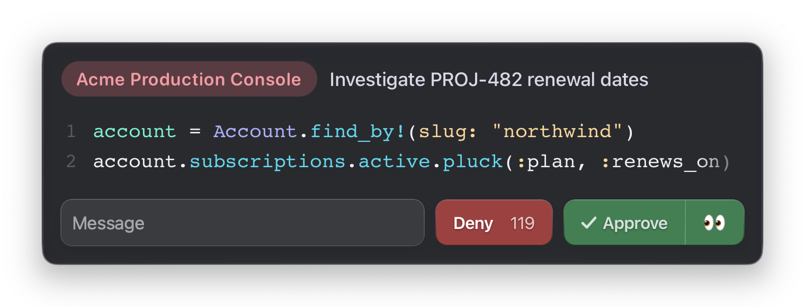

# Airlock

An approved, persistent remote terminal bridge for Claude Code on macOS.

> **Status: experimental. Airlock is an approval gate, not a security
> boundary.** It gates the path that goes through itself and nothing else. It
> does not stop a model that can reach the hosts another way (a local `ssh`, a
> `net-ssh` one-liner, the `tmux` CLI, the SSH agent socket), and it is only as
> strong as the sandbox and permission rules around it. Its own security review
> found gaps that are not yet fixed, including ways remote output can fake a
> command's completion and SSH configuration that runs more than the overlay
> shows. Read [SECURITY.md](SECURITY.md) before pointing it at anything you
> care about, and treat it as an approval UX with an audit trail, not as what
> keeps an agent off production.



Airlock MCP gives your agent a human-gated channel into a persistent SSH shell or
a Rails console. Every crossing of the airlock requires explicit
approval in a native overlay rendered by the bridge — syntax-highlighted,
human-readable command text. What the overlay shows is what the bridge sends;
the known cases where that can be made to differ from what the remote shell
executes are tracked in [SECURITY.md](SECURITY.md).

## Install

You need macOS 26 or later on Apple silicon, an admin account, and Claude
Code. Paste this into a Claude Code session, and it asks which SSH hosts to
add and whether to block direct SSH, shows each change before applying it, and
hands you the commands that need `sudo`:

```text
Read https://github.com/unabridged/airlock/blob/main/docs/agent-install.md and guide me through installing this tool. Ask me about configuration choices, show changes before applying them, and have me execute privileged commands myself.
```

To install by hand, follow the [manual install](docs/install.md). To build the
package yourself, see
[Install from source](docs/development.md#install-from-source).

## Using it

Agent sees five tools:

| Tool | Approval | What it does |
| --- | --- | --- |
| `list_targets` | none | Lists the configured targets (name, description, the exact command an open would run). |
| `open_terminal` | overlay | Starts the session for one target: `ssh <alias>`, then the target's startup lines (e.g. `bin/rails console`). |
| `send_terminal` | overlay | Types one command into the session and returns the captured output. |
| `interrupt_terminal` | overlay | Sends a real Ctrl-C to the running command. |
| `close_terminal` | none | Exits the remote program and tears the session down. |

Deny can carry a feedback note, which rides back to the agent so it can adjust 
and resend.

**Style contract:** `send_terminal` checks every command against a style
contract before the overlay pops, so the human only reviews text they can read
at a glance. The overlay shows every approved byte at 80 columns without a
fade. The bridge enforces these rules, and the tool description teaches them to
the agent:

- At most 80 columns per line, and at most 60 lines and 32 KiB per send.
- One statement per line. Shell control flow such as `for f in *.log; do wc -l
  $f; done` is the one allowed use of `;`.
- No comment lines.
- Full-word variable names, such as `order` rather than `o` or `tmp`.
- Spaces around `=` and after every comma.
- Exactly one blank line between sections, and a multi-section command prints
  labeled values such as `puts "count: #{count}"`.
- Arrays fill-wrapped, never one element per line.
- No trailing spaces.
- No tabs, control characters, zero-width or bidirectional characters, or
  non-ASCII spaces.

The bridge never reformats a command. Its only change is dropping one trailing
newline. A rejected command never reaches the human, and the rejection lists
every problem so the agent fixes them in one resend:

```text
send_terminal rejected before approval: the command breaks the style contract (2 problems). The human has NOT seen it.
  - line 1, col 1: [name] variable `u` — use the full name of the object it holds (e.g. `order`, not `o`)
      "u = User.find(1234); puts u.email"
  - line 1, col 20: [statements] 2 statements joined by `;` — one statement per line
      "u = User.find(1234); puts u.email"
Fix every item and resend the whole command. If an item cannot be satisfied for this command, stop and relay this message to the human instead of retrying.
```

The character rule also runs over the configuration at load: `instructions`,
each target's `display_command`, and its `startup` lines.

Sessions are persistent and exclusive: one active session across all
windows, and console state (variables, loaded records) survives between
approved commands. If `open_terminal` refuses because a previous session is
still alive, attach to it and exit the remote program yourself — leftover
sessions are never killed automatically.

**Watch the session:** run `/usr/local/libexec/airlock/bin/airlock-attach`
once in Claude Desktop's integrated terminal and leave it running. It idles
until a session opens, attaches to the same PTY the agent drives (you can type
into it — e.g. to answer SSH host-key or 2FA prompts), and goes back to idling
when the session closes. Every successful `open_terminal` result carries this
command as a one-click Run block, so there is no path to remember. The
installed client and the overlay's watch button read only the system terminal
database, so a terminal whose `TERM` has no entry in `/usr/share/terminfo`
(such as `xterm-ghostty` or `xterm-kitty`) is attached as `xterm-256color`.

## Documentation

- [Manual install](docs/install.md): the package, the target config,
  registration, blocking the direct path, upgrades, and uninstalling.
- [Agent install](docs/agent-install.md): the steps the paste-in prompt has
  Claude Code follow.
- [Development](docs/development.md): installing from source, tests, the
  development instance, building the package, releasing, and the repository
  layout.
- [SECURITY.md](SECURITY.md): the threat model, the assumptions the gate
  depends on, and the open findings from the hardening review.
- [PLAN.md](PLAN.md): the build plan, kept as a design reference.
